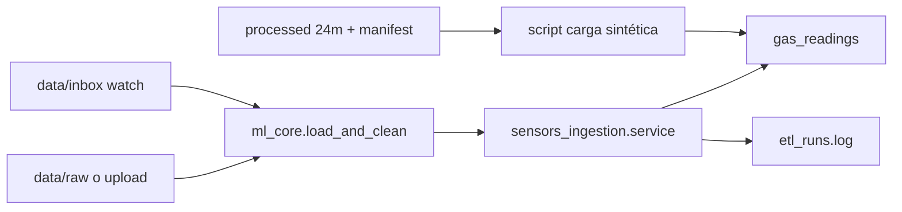

# Plan de ejecución — Ingesta y ETL de sensores (Plan 03)

## Overview

Implementar el Plan 03 de ingesta ETL extrayendo la lógica de los notebooks y `data/` ya añadidos al repo: `ml_core` con lectura/normalización de `dls_report`, módulo `sensors_ingestion` (tablas + API), job por carpeta `data/inbox/`, y carga de datos sintéticos 24m con `is_synthetic`.

## Contexto

Planes 01–02 hechos. **No hay** módulo de sensores ni `ml_core` real. La fuente de verdad del pipeline ya está en este repo:

- Raw: `data/raw/dls_report_*.xlsx` (~56 archivos; hoja `Resumen`, cabecera fila **24**)
- Lógica de lectura/normalización: `notebooks/01_exploracion.ipynb` (`cargar_dls_report`)
- Canónico 15 columnas: `data/processed/Procesamiento_de_Datos.csv`
- Aumentado 24m + trazabilidad: `Procesamiento_de_Datos_24m.csv` + `augmentation_manifest.json`

**Decisiones fijas:**

- No depender de un repo externo `proyecto-gases`; portar desde notebooks/`data`.
- Automatización con **APScheduler + carpeta `data/inbox/`** (sin Celery/Redis en esta fase).
- La aumentación 24m se incluye cargando el CSV/manifest existentes (no reescribir el generador desde cero).



## 1. Librería `ml_core/`

Extraer desde `notebooks/01_exploracion.ipynb`:

| Artefacto | Contenido |
|-----------|-----------|
| `ml_core/columns.py` | `EXPECTED_COLUMNS` (15 cols canónicas del CSV) + alias de cabeceras Excel |
| `ml_core/data_io.py` | `load_dls_report(path)`, `load_and_clean(paths) -> DataFrame` (ffill Sensor/Periodo, filtrar `Leyendo` numérica, normalizar fechas/números, validar columnas; filas rechazadas con motivo) |
| `ml_core/augmentation.py` | Helpers para marcar sintéticos usando `augmentation_manifest.json` al cargar el CSV 24m |
| Actualizar `ml_core/__init__.py` | Exportar API pública |

Deps nuevas en `requirements.txt`: `pandas`, `openpyxl`.

**Prueba:** `python -c "from ml_core.data_io import load_and_clean; ..."` sobre 1–2 Excel de `data/raw`.

## 2. Modelos y migración

Módulo `app/modules/sensors_ingestion/` siguiendo la convención (models/schemas/repository/service/router):

```
sites(id, name UNIQUE, description)
sensors(id, site_id FK, code UNIQUE, gas_type, unit)
gas_readings(id, sensor_id FK, leyendo, unidad, stel_max, twa_max, alarma,
             temperatura, tiempo_inicio, tiempo_fin, is_synthetic BOOL,
             source_file, etl_run_id FK, created_at)
etl_runs(id, started_at, finished_at, status, rows_ingested, rows_rejected,
         source_files JSONB, log JSONB, triggered_by_user_id FK nullable)
```

Índice compuesto: `gas_readings(sensor_id, tiempo_inicio)`. Registrar modelos en `migrations/env.py`. Migración Alembic `sensors_etl`.

## 3. Repository + service

- `get_or_create_site`, `get_or_create_sensor` (code = texto Sensor; gas_type desde Descripción/Gas).
- `bulk_insert_readings` vía `bulk_insert_mappings` en lotes (~5k).
- `create_etl_run` / `update_etl_run`.
- Service orquesta: leer → limpiar (`ml_core`) → resolver site/sensor → insertar (`is_synthetic=false`) → log estructurado en `etl_runs.log` (columnas normalizadas, rangos de fecha, filas rechazadas + motivo, advertencias).
- Auditoría: `record_audit(..., action="ingestion.upload", resource_id=etl_run_id)` en ingestas manuales.

## 4. API (permiso `sensors.manage`)

| Método | Ruta | Rol |
|--------|------|-----|
| POST | `/ingestion/upload` | Uno o más `UploadFile` (xlsx); sync; responde resumen `etl_run` |
| GET | `/ingestion/runs` | Historial paginado |
| GET | `/ingestion/runs/{id}` | Detalle + log |

Registrar router en `app/main.py`.

## 5. Automatización inbox

- Carpeta `data/inbox/` (+ `.gitkeep`); archivos procesados → `data/inbox/processed/` o `data/inbox/failed/`.
- `scripts/run_etl_inbox.py`: procesa pendientes con el mismo service.
- Job **APScheduler** en la app (flag `ETL_INBOX_ENABLED=true`): intervalo configurable (`ETL_INBOX_INTERVAL_SECONDS`, default 60), sin Redis.

Variables en `.env.example`.

## 6. Datos sintéticos 24m

Script `scripts/load_processed_dataset.py`:

- Carga `Procesamiento_de_Datos.csv` → `is_synthetic=false` (opcional si ya se ingirió desde Excel).
- Carga `Procesamiento_de_Datos_24m.csv` + manifest → filas sintéticas con `is_synthetic=true`; guarda resumen del manifest en `etl_runs.log`.

**Prueba DoD:** `SELECT is_synthetic, count(*) FROM gas_readings GROUP BY 1`.

## 7. Tests y docs

| Test | Cubre |
|------|--------|
| `tests/unit/test_ml_core_data_io.py` | Normalización/columnas sobre Excel de muestra |
| `tests/integration/test_ingestion.py` | Upload autenticado admin → `rows_ingested > 0`; sin permiso → 403; `etl_runs.log` con transformaciones |

Actualizar `README.md` y estado en `planes/00_INDICE_Y_ROADMAP.md` (Plan 03 completado).

## Orden de implementación

1. `ml_core` + deps pandas/openpyxl
2. Modelos + migración
3. Repository/service + tests unitarios de limpieza
4. Router upload/runs + auditoría
5. Inbox script + APScheduler
6. Script carga CSV/24m sintéticos
7. Tests integración + docs

## Definition of Done

- Excel real (`dls_report`) produce lecturas + log de transformaciones en `etl_runs`
- Endpoint protegido por `sensors.manage` y auditado
- `is_synthetic` filtrable; conteos real vs sintético coherentes tras carga 24m
- Bulk insert razonable (< 1 min para volumen tipo 24m en máquina local)
- Inbox: archivo nuevo → nueva fila `etl_runs` con `status=success`

## Todos

- [ ] Portar lógica notebooks a ml_core (columns, data_io, augmentation) + deps pandas/openpyxl
- [ ] Modelos sites/sensors/gas_readings/etl_runs + migración Alembic
- [ ] Repository bulk insert + service ETL con log estructurado
- [ ] Router /ingestion/upload y /runs con sensors.manage + audit
- [ ] data/inbox + script + APScheduler opcional
- [ ] Script carga CSV consolidado/24m con is_synthetic + manifest
- [ ] Tests unit/integración y actualizar README + índice planes
